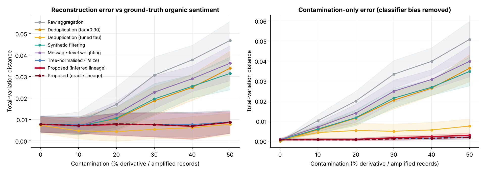
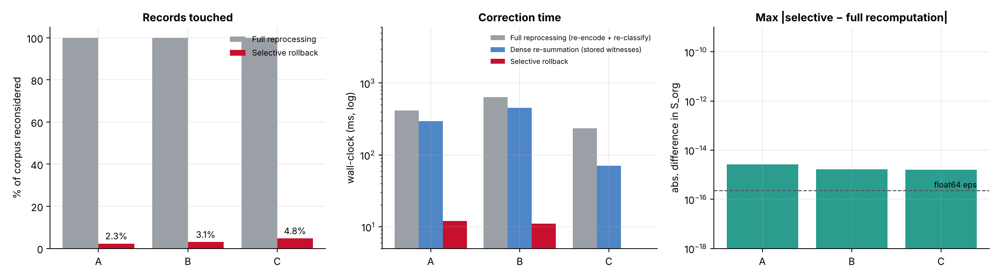

# Opinion Lineage System

[](https://github.com/Samvibhanshu/opinion-lineage/actions/workflows/ci.yml)

**Confidence-weighted opinion lineage for self-correcting sentiment aggregation**: reference implementation and
simulation suite.

Social-media sentiment is usually measured by counting posts, so one opinion copied a thousand times (reposts,
paraphrases, AI rewrites, coordinated campaigns) counts a thousand times. This project builds a graph of which post
derives from which, weights every post by how independent it is, and reports *organic* sentiment next to the raw
count. When a source is later found to be fake, only the posts that descend from it are re-weighted, with no model
re-runs, and the result is exactly what a full recomputation would give. A retrieval-augmented question-answering
layer on top answers "how do people feel about X?" from provenance-weighted evidence.

Working code for the patent *"Confidence-Weighted Opinion Lineage System for Self-Correcting Sentiment Aggregation and
Selective Provenance-Based Historical Correction"* (Indian application 202641115708): every formula of the
disclosure is implemented, tested, and benchmarked against baselines on a controlled synthetic social-media stream.

```
pip install -r requirements.txt
python3 -m pytest -q tests   # 27 tests, a few seconds
./run_all.sh            # tests + all experiments + figures   (about 10 min on 2 CPU cores)
python3 examples_demo.py   # 1-minute tour (patent's A→B→C→D example)
python3 rag_demo.py --topic 0 --expose   # NEW: ask the lineage-aware RAG a question, then expose a compromised feed
```

**New: a retrieval-augmented-generation layer** (`opinion_lineage/rag/`) answers questions such as *"How do people feel about
the metro fare hike?"* from retrieved posts, cites quotable evidence, says how much of the volume is amplification, abstains
when too little independent evidence is left, and is **correctable in place** when a source is later retracted. See the
section "Lineage-aware RAG" below, including where it does **not** beat a simple baseline.

## What is implemented (patent → code)

| Patent element | Code |
|---|---|
| Opinion-Lineage Graph, edge-insertion rule (τ1..τ4), typed edges REPOST_OF / QUOTES / PARAPHRASES / AI_DERIVATIVE_OF / COORDINATED_WITH / UNCERTAIN_DEPENDENCY, primary-parent selection, incremental G_t | `opinion_lineage/lineage.py` |
| W_i = P_ind(r(i)) · Π(1−α c_e) · (1−β P_syn) · (1−γ P_coord) | `weighting.py` |
| S_obs, S_org, Sentiment Contamination Index, independent vs amplification mass | `aggregate.py` |
| Sentiment Contribution Witness, versioned repository, (A, Z) pair per day-bucket, audit log | `store.py` |
| Selective Dependency Rollback: D(v), q_{v,u}=Πc_e, W′=W+q(W̃−W), ΔA, ΔZ, O(\|D(v)\|) | `rollback.py` |
| Independent dense re-summation & full model reprocessing (reference for equivalence) | `reference.py` |
| Instrumented encoder / classifier (forward-pass ledger → "zero model executions" is measured) | `models.py` |
| Ground-truth stream generator (cascades, campaigns, AI paraphrases, sleeper feeds) | `simulate.py` |

## Results (all reproducible; raw runs in `results/*.csv|json`, figures in `results/figures/`)

**E1 – Reconstruction error vs contamination** (TVD to ground-truth organic sentiment, N=6,000, 12 seeds, mean ± sd)

| Method | 0% | 20% | 40% | 50% |
|---|---|---|---|---|
| Raw aggregation | 0.0077 | 0.0170 | 0.0378 | 0.0468 |
| Deduplication (τ=0.90) | 0.0077 | 0.0103 | 0.0249 | 0.0339 |
| Synthetic filtering | 0.0077 | 0.0105 | 0.0255 | 0.0314 |
| Message-level weighting | 0.0077 | 0.0124 | 0.0290 | 0.0362 |
| Tree-normalised weighting (1/lineage size) | 0.0079 | 0.0077 | 0.0076 | 0.0088 |
| **Proposed (inferred lineage)** | **0.0077** | **0.0076** | **0.0068** | **0.0086** |
| Deduplication, threshold tuned on ground truth* | 0.0073 | 0.0043 | 0.0062 | 0.0078 |

\*An optimistic baseline: its threshold is picked using the answer. Against it the proposed method is **comparable, not
better**. The advantage over any fixed/untuned baseline is clear; over a perfectly-tuned dedup it is not. A simple
tree-normalised weighting (every lineage counts once, using the same inferred lineage) is close behind (0.0076 vs
0.0068 at 40%), so most of the gain comes from knowing the lineage, not from the exact weighting formula. Full table:
`results/e1_contamination_table.md`.



**E2 – Ablation @40%** (20 paired seeds): removing lineage structure triples the error (0.0101 → 0.0217, Wilcoxon p=0.002).
The independence/synthetic terms add nothing measurable here (lineage-only 0.0086 and lineage+synthetic 0.0090 are
nominally *better* than the full formula, p≈0.06–0.10): the improvement comes from the lineage structure.

**E3 – Lineage inference** @40%: root accuracy 0.975, derivative precision 0.948 / recall 0.992 (F1 0.969), correct-lineage accuracy 0.940.

**E4 – Selective Dependency Rollback, 50,000 records (10k roots / 40k derivatives)**



| Scenario | Events | Records touched | Model rows re-run (sel. / full) | Time sel. / dense / full-reproc. | max \|Δ S_org\| vs full |
|---|---|---|---|---|---|
| A: 200 invalid roots (patent scenario) | 200 | 1,165 (2.3%) | 0 / 50,000 enc + 50,000 clf | 16 ms / 428 ms / 511 ms | 2.6e-15 |
| B: mixed stream (root, edge, synthetic) | 400 | 1,529 (3.1%) | 0 / 50,000 + 50,000 | 22 ms / 759 ms / 810 ms | 1.7e-15 |
| C: takedown of the 40 largest lineages | 40 | 2,390 (4.8%) | 0 / 50,000 + 50,000 | 15 ms / 125 ms / 242 ms | 1.6e-15 |

**E5 – Scaling:** for ~1,000 affected records the selective cost stays flat (≈7.5–8.7 ms) from N=10k to 200k while dense
re-summation grows 66 → 2,555 ms; at fixed N the cost is linear in \|D(v)\| (≈160 µs + 1.2 µs·\|D\|).

**E6 – Retroactive correction:** a compromised "sleeper" feed (19.6% of roots) is trusted, then exposed. Rollback revises
2,470 roots (16.8% of records, 0 model calls); corpus-level error 0.064 (raw) → 0.038 (published) → **0.005** (after rollback), equal to full recomputation to 9e-16.

**E7 – Sensitivity:** error stays 0.0057–0.0080 over a τ1×τ2 grid (raw: ≈0.030–0.047). Validation-tuned (α,β,γ) = (0.9, 0, 0) gives 0.0091 vs 0.0096 default on held-out corpora (raw 0.0304).


## Lineage-aware RAG (`opinion_lineage/rag/`)

```
question ──► text index (TF-IDF, lineage-blind) ──► top-K candidates ──► lineage layer ──► grounded answer + citations
                                                                          │  W_i, root, P_ind from the OpinionStore
 source retracted ──► Selective Dependency Rollback ─────────────────────┘  (weights change in place; nothing re-embedded / re-indexed)
```

| Part | Code | What it does |
|---|---|---|
| Text renderer | `rag/textgen.py` | writes a post for every simulated record (verbatim reposts, quotes, synonym paraphrases, AI rewrites, keyword-stuffed campaign posts, talking-point reuse); own RNG, so E1-E7 are unchanged |
| Index | `rag/retrieval.py` | word 1-2-gram TF-IDF; deliberately lineage-blind, so any retriever can be swapped in |
| Strategies | `rag/strategies.py` | naive RAG (top-m, all-K), MMR, text near-duplicate collapse, text dedup + provenance score, **lineage-aware** (one evidence slot per lineage, ranked by relevance x weight, statistic = sum W_i P_i / sum W_i, abstains below an evidence floor) |
| Generators + guardrails | `rag/generate.py` | deterministic extractive generator (no hallucination possible); `LLMGenerator` for any `complete(prompt)` callable that builds a lineage-annotated prompt, **rejects answers citing ids outside the evidence**, and falls back to the extractive answer; `verify_answer` audits every statistic and quote |
| System | `rag/system.py` | `LineageRAG.ask(...)`, `retract(events)`, `invalidated(cached_answers)` (precise cache invalidation from the audit log), `reference_rebuild()` (conventional full recomputation, for comparison) |

Example (`python3 rag_demo.py --topic 0 --expose`): the plain RAG's 8-post context here has four copies of one campaign post ("BREAKING: ... Share if you agree"; on average 82% of its cited posts are campaign posts at 40% contamination), while
the lineage-aware answer reports 36/26/38% (truth 30/32/38%), says the 300 retrieved posts reduce to ~126 independent opinions,
and quotes eight distinct independent posts.

### Results (synthetic stream; 6,000 posts, 8 topic questions per seed, 8 seeds; truth = organic independent posts of the topic)

**R1 - answer error (TVD to the organic truth) vs contamination.** All strategies see the same top-300 candidates.

| Method | 0% | 20% | 40% | 50% |
|---|---|---|---|---|
| Naive RAG, top-8 context | 0.1356 | 0.1639 | 0.1996 | 0.1914 |
| Naive RAG, count over all 300 | 0.0306 | 0.0636 | 0.0979 | 0.1204 |
| MMR diversification (8) | 0.1179 | 0.1290 | 0.1277 | 0.1523 |
| Text near-duplicate collapse (tau 0.8) | 0.0308 | 0.0378 | 0.0648 | 0.1035 |
| **Text dedup + provenance score** | 0.0310 | 0.0374 | **0.0579** | **0.0931** |
| **Lineage-aware RAG (ours)** | 0.0306 | 0.0384 | 0.0611 | 0.0970 |
| Lineage-aware RAG, oracle lineage | 0.0307 | 0.0388 | 0.0660 | 0.1089 |

* **Clear win over plain RAG:** at 40% the error falls from 0.098 (all-K count) and 0.200 (8-post context) to 0.061; Wilcoxon p = 0.008 against both (8 of 8 seeds).
* **No win over a strong simple baseline:** *text dedup + provenance score* (collapse near-duplicate texts, then weight each survivor by the provenance layer's independence score) is as accurate (0.0579 vs 0.0611 at 40%, p = 0.55; 0.0931 vs 0.0970 at 50%, p = 0.20). In this simulator the lineage graph does **not** improve answer accuracy over that baseline.
* The oracle (true) lineage is not better than the inferred one (0.0660 vs 0.0611 at 40%): lineage-inference error is not what limits accuracy here.

**Evidence quality at 40%** (the 8 posts shown to the reader/LLM):

| | independent organic posts | distinct lineages | campaign / sleeper posts |
|---|---|---|---|
| Naive RAG | 4% | 48% | 82% |
| MMR | 25% | 87% | 51% |
| Text near-duplicate collapse | 12% | 73% | 74% |
| Text dedup + provenance score | 89% | 98% | 10% |
| **Lineage-aware** | **89%** | **98%** | **10%** |

Plain RAG's context window is crowded by copies because keyword-stuffed campaign posts and their copies are the most similar to the question.
Retrieval relevance is not hurt (99.9% of retrieved posts are on-topic for every method).

**R2 - which weights matter (40%; paired Wilcoxon vs full W):** full W 0.0611; *tree-normalised 1/size* **0.0516** (p = 0.039, nominally better);
lineage structure only 0.0717 (p = 0.023); message-level weights with no lineage 0.0925 (p = 0.008); roots only 0.0666 (p = 0.25).
Lineage structure matters, but the full formula is not the best variant, as in E2 of the patent suite.

**R3 - grounding audit:** 512 of 512 answers pass `verify_answer` (statistics recomputed from evidence, citations in evidence, quotes verbatim). This is by construction for the extractive generator; it is a regression guard, not evidence about an LLM.

**R4 - retroactive correction of the RAG** (a compromised "sleeper" feed, 20% of roots, is trusted and then exposed; 8 seeds):

| System | error before | error after | share of answer weight from the feed, before / after | feed posts among cited, after |
|---|---|---|---|---|
| Naive RAG + delete exposed posts | 0.1055 | 0.0960 | 12.3% / 2.7% | 6.4% |
| Naive RAG + delete whole family (oracle) | 0.1055 | 0.0945 | 12.3% / 0.0% | 0.0% |
| Text dedup + provenance score | 0.0847 | 0.0662 | 21.6% / 3.2% | 1.6% |
| **Lineage-aware (selective rollback)** | 0.0853 | 0.0670 | 22.2% / 3.0% | 0.6% |

* Lineage-aware RAG and the dedup + provenance baseline correct equally well (error 0.0670 vs 0.0662, p = 0.84). Both beat deleting the exposed posts from a naive RAG (0.096, p = 0.008) - deleting roots leaves their reposts and paraphrases behind.
* **Before the exposure, the lineage-aware answer leans on the sleeper feed more (22% of weight vs 12% for naive RAG)**, because it discounts organic reposts while the sleepers still look independent. A lineage-aware answer is only as good as the provenance scores it starts from.
* **Cost and exactness (what the patent claims):** exposing 798 roots re-weights 1,038 posts (17.3%) in about 17 ms with **0 posts re-embedded and the index untouched**, versus re-encoding all 6,000 posts (12,000 model rows) and rebuilding the index (about 0.23 s with the stand-in models). The result equals full recomputation to floating-point precision (max |dW| and |dS| below 1e-12). The wall-clock gap is small because the stand-in models are tiny; the model-row count is the robust number.
* **Precise cache invalidation:** retracting one lineage invalidates 2.25 of 24 cached answers on average (about 9%); the rest are provably unaffected and need no regeneration.

**R5 - text-disguise stress test (40% contamination).** Copies are rewritten instead of copied verbatim with probability d:

| Method | d = 0 | d = 0.5 | d = 1.0 |
|---|---|---|---|
| Naive RAG (all K) | 0.1110 | 0.1029 | 0.1024 |
| Text near-duplicate collapse | 0.0776 | 0.0772 | 0.0734 |
| Text dedup + provenance score | 0.0679 | 0.0643 | 0.0584 |
| **Lineage-aware** | 0.0700 | 0.0646 | **0.0551** |

Only when every copy is disguised does lineage-aware RAG beat the dedup + provenance baseline (0.0551 vs 0.0584, p = 0.023, a small margin). **Caveat:** the lineage graph is built from the embedding channel, which the renderer does not alter, so it is unaffected by construction; a real encoder would degrade as rewrites drift, so treat this as "where text-level methods break", not as a measured advantage.

**R6 - efficiency** (2 CPU cores, stand-in models): 6k / 12k / 24k posts: p50 answer latency 1.8 / 2.4 / 3.4 ms including the grounding audit (naive RAG 1.5 / 2.1 / 3.1 ms); index + store build 0.3 / 0.6 / 1.4 s; applying a retraction of 348 / 671 / 1,275 events 11 / 13 / 25 ms versus a conventional rebuild of 0.19 / 0.36 / 1.0 s.

### What the RAG layer is, and is not

* It **is** a working, tested retrieval-augmented answering system whose answers are weighted by provenance, whose evidence is one-slot-per-lineage, whose citations are audited, and which updates in place and invalidates cached answers precisely.
* It **is not** evidence that the lineage graph beats a well-built text-dedup-plus-provenance pipeline on accuracy. In this simulator it does not (R1, R4); its distinct contributions are the explicit amplification accounting ("these 300 posts are about 126 independent opinions in 169 lineages"), the principled propagation of a retraction to descendants, and exact, auditable, cheap correction.
* No real LLM was called. The experiments use the extractive generator; the answer sentiment is computed from the evidence, which is what an LLM would be conditioned on. The `LLMGenerator` is tested with a stub only.
* The posts are rendered from the simulator's latent state, so the embedding channel (used for lineage) and the text channel (used for retrieval) are generated from the same ground truth. With real text and a real encoder they would disagree in ways this simulator cannot show.
* The 8 topics, 3 question templates and the vocabulary are small and closed. Retrieval is a TF-IDF index, not a dense retriever, and every question is a topic-level opinion question (no multi-hop or numeric questions).

## Honest limitations — read before quoting any number

1. **Synthetic data, not a real dataset such as TweetEval.** The stream is simulated (embeddings from a
   fixed random encoder, sentiment classifier ≈ 70% accurate, provenance/synthetic scores drawn from Beta
   distributions). Absolute errors therefore differ from the patent's (e.g. its 0.078 floor); only the *relative*
   behaviour is comparable. Swap in real embeddings/classifier via `Encoder` / `SentimentModel` (same interface).
2. **The models are tiny stand-ins.** Wall-clock speed-ups vs "full reprocessing" would be orders of magnitude larger with real transformers; the forward-pass *counts* (0 vs 50,000) are the robust claim.
3. **Equivalence is to the same propagation rule**, as the patent states. The rule W′=W+q(W̃−W) with q<1 is *not idempotent*:
   re-applying the same revision moves the weights further toward W̃ (tested behaviour, `test_partial_retraction_*`).
   If a claim must hold under repeated/duplicate events, add an event-ID de-duplication step or store W̃ and the applied fraction.
4. Rollback requires **no change of the primary-parent structure**; re-parenting a subtree is out of scope (edge-confidence revision is supported).
5. Lineage construction is exact O(N²) block-matrix similarity (≈12 s for 50k records); production scale would need an ANN index.
6. "Amplification mass" is defined here as N − ΣW (the patent does not give a formula).

## Layout

`opinion_lineage/` library (`rag/` = the RAG layer) · `tests/` 27 pytest tests (12 for the framework, 15 for the RAG layer: determinism, topic precision, formula, grounding, one-slot-per-lineage, in-place retraction ≡ dense recomputation with zero model calls, abstention, hallucinated-citation rejection, precise invalidation) · `experiments/` E1–E7 (patent suite) and R1–R6 (`exp6`–`exp9`, RAG) · `examples_demo.py`, `rag_demo.py` · `results/` CSV/JSON/log, `results/figures/` PNG.
